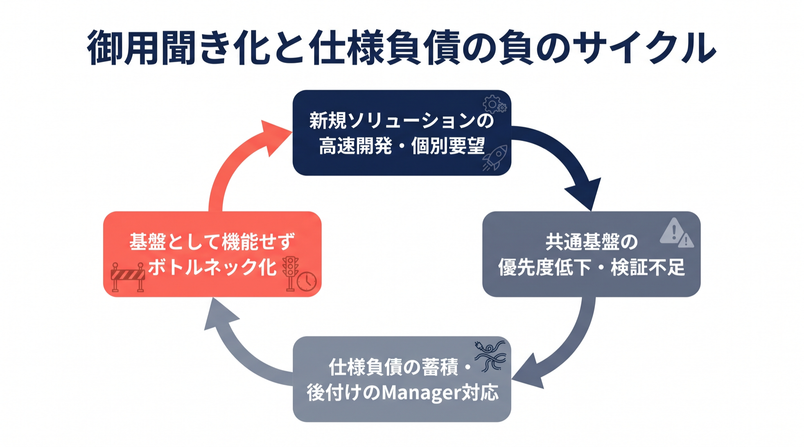
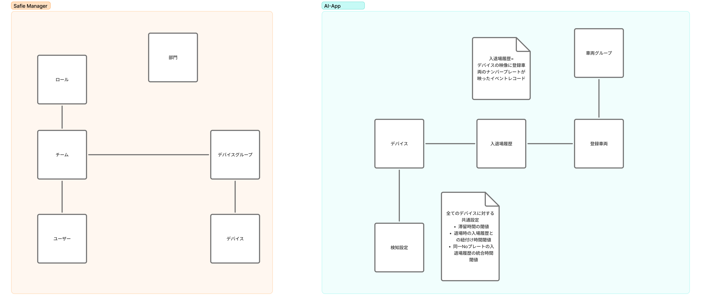
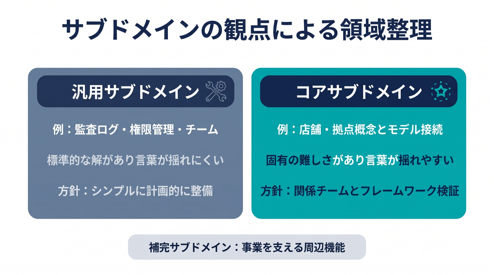
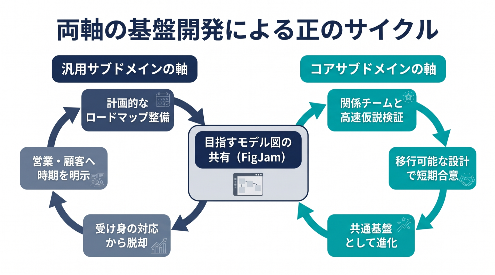

この記事は[セーフィー Advent Calendar](https://adventar.org/calendars/13063) 3日目の記事です。

セーフィーでプロダクトマネージャーをしている若野です。Safie Managerという、セーフィーのカメラを活用するための統合管理ツールを担当しています。

Safie Manager（セーフィーマネージャー）公式サイト

Safie Managerは、セーフィーのさまざまなソリューションをエンタープライズのユースケースでも利用できるようにする統合管理ツールです。機能の一例として、以下があります。

- ユーザー管理
- デバイス管理
- 権限管理
- SSO
- IPアドレス制限

この記事では、複数のソリューションを支える基盤プロダクトにおいて、「他チームからの個別要望に追われて本来やるべき基盤開発が進まない」という課題に、ドメイン駆動設計のサブドメインの概念とモデリングを用いて向き合ったプロダクトマネジメントの実践知を紹介します。

プラットフォーム開発に関わるPMやテックリード、エンジニアの方の参考になれば幸いです。

## 当たり前の体験の開発がなかなか始められない

再掲ですが先ほど紹介した以下の機能は、エンタープライズのお客様にとって「あって当たり前」であり、セーフィーを利用するうえで不可欠な体験です。

- ユーザー管理
- デバイス管理
- 権限管理
- SSO
- IPアドレス制限

これら機能はエンタープライズ向けSaaSに求められる標準要件として私は[EnterpriseReady](https://www.enterpriseready.io/#features) のための機能と呼んでいます。

統合管理ツールであるSafie Managerには、これらを粛々と計画し、実装・提供していくことが求められていました。

これらの機能はセーフィー独自のものではなく、一般的な監査・セキュリティ基準に準拠したプラクティスが存在する、提供価値の不確実性が比較的低い領域です。そのため、当初は「計画通りに粛々と進められそうだ」と考えていました。

しかし蓋を開けてみると、そもそもこれらの機能の設計にすら入れず、ひたすら他のソリューションからの個別要望と既存の仕様の調整をし続ける日々でした。

基盤プロダクトとしてセーフィー全体の根本課題に向き合うアクションを起こさなければならないと感じました。

## 【課題】基盤プロダクトなのに個別対応が必要という矛盾

セーフィーでは、さまざまなドメインでソリューションの検証や開発が高速で進んでいます。2026年は、PR TIMES上で月平均2本以上の新ソリューションに関するプレスリリースを出しています。

セーフィー株式会社のプレスリリース一覧（PR TIMES）

それだけセーフィーをご利用いただくユースケースや業界が広がり、Safie Managerには顧客だけでなく、社内の各ソリューションチームからも多くの要望が寄せられるようになりました。

特に収益事業を担うソリューションからは、事業検証を速く進めるため、短いタイムラインでの対応が求められます。中にはリリース要件として顧客と合意済みのケースもあり、Safie Managerでは次のような状況が続いていました。

- **個別要望への対応が優先される：** 監査ログやSSOなど、ロードマップに載せていた基盤機能の優先度を下げ、個別の要望やタイムラインに合わせてスコープを決めていた
- **十分に検証できないまま機能が増える：** 限られた時間の中で、仮説検証が不十分なまま機能が積み重なっていた
- **共通仕様も現場にフィットしない：** 基盤側から共通仕様を提案しても、検証を十分に回す前に次の要望が重なり、現場に合わない仕様が残ることがあった

その場の課題は解決できても、他のソリューションからも使える基盤としては育ちにくい。その積み重ねが仕様負債につながっていました。



こうした背景から個々のソリューションは事業検証のサイクルを早めるため、初期リリースではSafie Managerという基盤プロダクトに対応しない方針を取ることが多々ありました。その結果、基盤プロダクトであるはずなのに、後から行う個別対応を指して社内で「Manager対応」という言葉が生まれていました。

ソリューションの個別要望に応えること自体はビジネス上重要です。ただ、管理基盤とソリューションの双方が目指す姿をすり合わせ、その実現に向けた設計を考えないまま対応を重ねると、基盤チームは「御用聞き」になりがちです。結果として、「基盤」としての本来の役割が果たせない状況に陥っていました。

この状態が続くと、セーフィー全体の成長サイクルのボトルネックになるだけでなく、チームとしても「自分たちはなぜここにいるのか？」という存在意義や前提が揃わなくなります。

そこで、まずは受け身ではなくSafie Managerとしてどこに向かうのかを自分たちで描くことにしました。プロダクトがどのようなサイクルの中にいて、何を求められており、どこが「Safie Managerでしか解決できない最もレバレッジの効くポイント」なのかを探ることにしたのです。

## 【取り組み】DDDのサブドメイン思考で領域を捉え直す

Safie Managerチーム内では、先に挙げた「個別要望への対応が優先される」「十分に検証できないまま機能が増える」「共通仕様が現場にフィットしない」という状況に対し、ほとんど全員から「仕様負債」という声が上がっていました。一方で、それがどの領域の、どのような難しさに起因しているのかまでは整理しきれていませんでした。

そこで、目の前の問題に個別に対応するだけでなく、まずSafie Managerが扱う領域の全体像を捉え直す必要があると考えました。

そこで取り組んだのが、ドメインモデリングです。とは言っても、Event Storming（イベントストーミング）やRDRA（ラドラ：要件定義手法）といった特定のプラクティスを全員にインプットする時間はなかったので、シンプルにプロダクト間の関係図を以下のようにまとめるところから始めてみました。（一部付箋は削除しています。）



目的は、詳細な仕様をその場で確定することではなく、**どこが比較的標準的に扱える領域で、どこにセーフィー固有の難しさや価値があるのかを見極め、チーム全体で共通認識を持つこと**です。

書籍[『ドメイン駆動設計をはじめよう』](https://www.oreilly.co.jp/books/9784814400737/)で述べられている「サブドメイン」の概念（事業領域を競争優位の源泉となる「コア」と、標準的なプラクティスが通用する「汎用」などに分類する考え方）を参考に、今後の開発で何を計画的に進め、何を重点的に探究すべきかを整理しました。



### どのような座組みで進めたのか

今回のモデリングは、閉じたチーム内だけのワークショップとして完結させるのではなく、**他チームとのコミュニケーション自体をモデリング形式にする**というアプローチを取りました。

具体的には、他ソリューションのチームとホワイトボードを囲み、関係者やビジネスモデルを確認しながら、各システムのドメインモデルのつながりや依存関係を可視化しました。さらに、実装やアーキテクチャ上の制約を整理し、そこで見えた構造や制約を各チームが持ち帰ったうえで、Safie Managerチーム内で詳細な要件やあるべきモデルへと落とし込んでいきました。

最初から完璧な正解を作ることは目指さず、「誰にとって、何を管理するための仕組みなのか」「他のソリューションとは何を介してつながるのか」といった問いを起点に、認識の違いや曖昧な点も含めてモデル図上で可視化していきました。

### 汎用サブドメイン：言葉の揺れが少なく計画的に整備できる領域

モデリングを進める中で、「監査ログ」「権限管理」「チーム」といった概念は、比較的言葉が揺れることなく共通の概念として出てきました。これらは顧客が統合管理ツールに期待する重要な機能である一方、世の中にも参考にできる標準的なプラクティスがある領域です。

もちろん、個々の要件や優先順位を検討する必要はあります。ただ、毎回ゼロから独自の解を探すのではなく、汎用サブドメイン（Enterprise Readyな基盤機能）としてシンプルに捉え、計画的に整備していくという方向性を持てました。

この整理によって、営業や他チームから要望が来た際にも、その都度抱え込むのではなく、ロードマップ上でいつ取り組む予定かを伝えるためのチーム内、チーム間の共通の土台ができました。

### コアサブドメイン：ソリューションと基盤のモデル接続が難しい独自領域

一方で、複数のソリューションやリソースをどう管理し、それぞれをSafie Managerとどうつなぐかという話になると、言葉や認識に大きな揺れが生じました。あるべき構造をすぐに描くというより、これまでに起きた問題や仕様負債の話が多く出てきたのも印象的でした。

たとえば、セーフィーには「AI-App人物検索」や「AI-Appナンバープレート認識」といったソリューションがあります。これらがSafie Managerに対応する前は、基本的に「1ユーザー（単一拠点前提）にデバイスが紐づき、そのデバイスに契約オプションやドメイン固有のデータ（人物や車両）が紐づく」というシンプルな構造をしています。単一拠点が前提のため、ソリューション側には「店舗」や「拠点」といったオブジェクトを束ねる集合の概念が存在しません。

しかし、Safie Managerでは複数拠点・複数デバイスの管理が前提となるため、「店舗」や「拠点」といった集合の概念が明示的に必要になります。さらに、ユーザーにデバイスが直接紐づくだけでなく、「ユーザーに権限が紐づき、その権限で操作できるスコープとしてデバイスや拠点が紐づく」という構造の違いもあります。

```
【単一拠点前提のソリューション構造】
ユーザー ──(直接紐づく)──▶ デバイス ──▶ 契約オプション / 固有データ（人物・車両など）
※「店舗」「拠点」という集合概念が存在しない

【複数拠点・統合管理（Safie Manager）の構造】
ユーザー ──▶ 権限（ロール） ──(操作スコープ)──▶ 店舗・拠点（集合概念） ──▶ デバイス
※ 組織階層とアクセス制御の抽象化が必要
```

このように、ソリューション単体の構造と統合管理の構造にギャップがある中で、「店舗や拠点といった集合概念をどのシステムがどう持ち、システム間の依存関係をどう設計するか」が極めて難しくなります。

標準的な解が見つかりにくく、プロダクト側で考えたものが実際の利用にフィットするかを検証し続ける必要がある。この領域こそが私たちSafie Managerチームにとって重点的に向き合うべき**コアサブドメイン**だと気づきました。

モデリングを通じて整理した2つの領域の特徴と向き合い方は、以下の通りです。

|  | **汎用的な領域** | **コアとなる領域** |
| --- | --- | --- |
| 例 | 監査ログ、権限管理、チーム | 店舗・拠点などの集合概念や、ソリューション間のモデル接続 |
| 議論で見えたこと | 比較的、言葉が揺れにくい | 言葉や認識に揺れがあり、仕様負債の話も多い |
| 向き合い方 | シンプルに、計画的に整備 | フレームワーク（叩き台）を定義し、関係チームと仮説検証を回す |

### 【成果】モデリングが変えた「ロードマップ」と「他チームとの対話」

この整理によって、これまでふわっとしていたビジネス・開発観点での負のサイクルに対して2つの改善のための武器をチーム単体だけでなく横断で手に入れることができました。

**1. ロードマップを「2軸」で引くようにした**
1つ目は、顧客にとってあって当たり前な「Enterprise Ready」な機能（汎用サブドメイン）を計画的に実行する軸。2つ目は、社内の他ソリューションチームの実装タイムラインに合わせて、モデル接続のフレームワークを検証・実装する軸（コアサブドメイン）です。性格の異なる開発を明確に分けたことで、優先度判断の迷いが減りました。

**2. 「目指すモデル図」を起点に交渉できるようになった**
他チームから「Manager対応」の相談が来た際、まずはホワイトボードで作成したモデル図を共有し、「Safie Managerとして最終的にこういう状態を目指している」という前提をすり合わせてから議論を始めるようにしました。

これまでは目の前の要件に対して「今ある穴をどう埋めるか」という議論が中心でした。しかし、最終的な目指す姿を共有できるようになったことで、「今回はタイムラインの都合で一時的な穴埋め対応になるかもしれないが、将来的にはこのモデルへ向かいたい。だからそれを前提に移行可能なアーキテクチャにしよう」という建設的な合意ができるようになりました。



モデリングによって明確なわかりやすいソリューションが生まれた訳ではありません。しかし、**それぞれの課題にどのような姿勢で向き合うかをチームで共有できたこと**が、受け身の開発から一歩踏み出すきっかけになりました。

## まとめ

今回の取り組みを通じて、統合管理ツールには、顧客にとって必要な「当たり前」を提供すると同時に、社内のさまざまなソリューションを支える基盤になるという、2つの役割があると捉えられるようになりました。

- **汎用サブドメイン：** 要望が来るたびに個別対応を検討するのではなく、計画的に整備する。そうすることで、営業からの要望にも、実施予定を含めて対話できるようになります。
- **コアサブドメイン：** 関係チームとともにモデルの接続やインターフェースを考え、フレームワークとしての設計を探究していく。目指す姿を共有できれば、短期的には穴埋めの対応を選ぶ場合でも、将来の基盤へ移行しやすいアーキテクチャを前提に議論できます。

汎用機能を着実に整えることと、独自の価値について仮説検証を速く回すこと。この両軸で、顧客体験と社内の開発体験をより良くしていきたいと考えています。

## We are hiring!

セーフィーでは現在、Safie Managerをはじめとするプラットフォーム・基盤領域のプロダクトマネージャーを募集しています。

セーフィーは、カメラやデバイス・現場といった「物理的なつながり」と、店舗・拠点・企業といった「組織的なつながり」の両方をうまく設計し、価値を提供しているプロダクトです。

その複雑な構造を読み解き、カオスな状況の中で抽象化・構造化しながら、顧客体験と開発体験の未来を描くことにワクワクする方、ぜひ一度カジュアルにお話ししましょう！

[セーフィー プラットフォーム・基盤領域 プロダクトマネージャー採用情報](https://open.talentio.com/r/1/c/safie/pages/107230)
